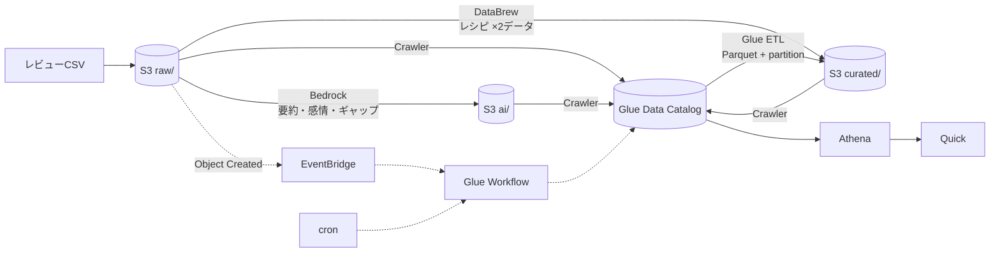
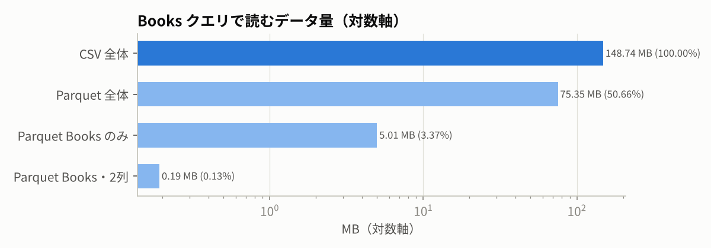
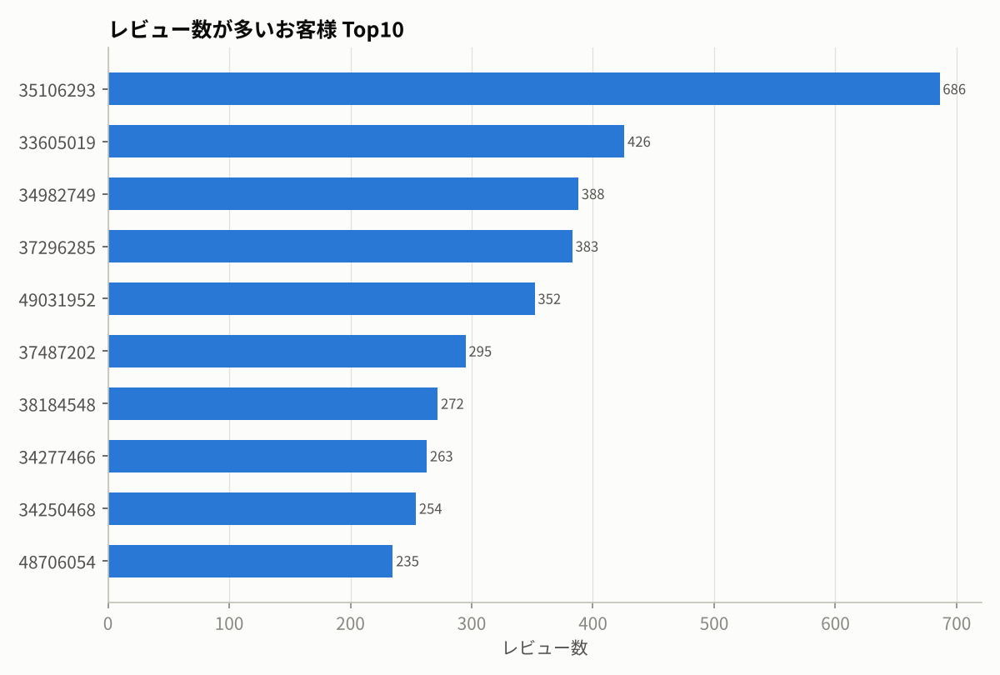
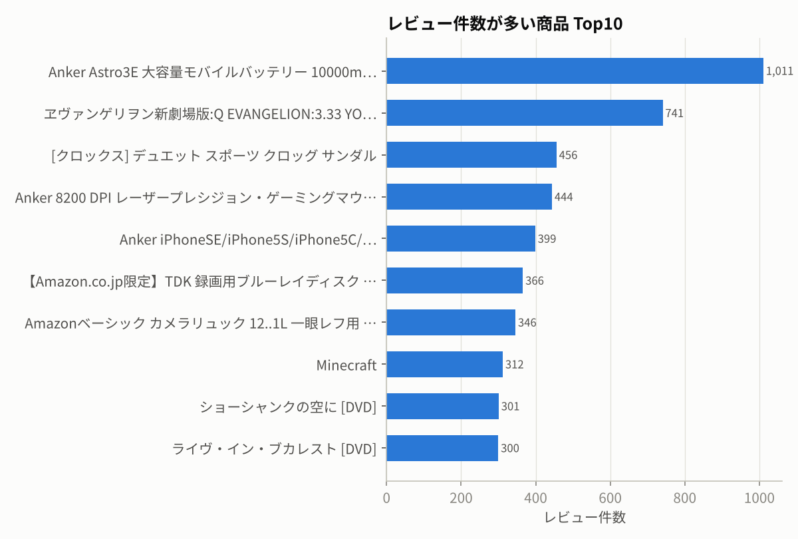
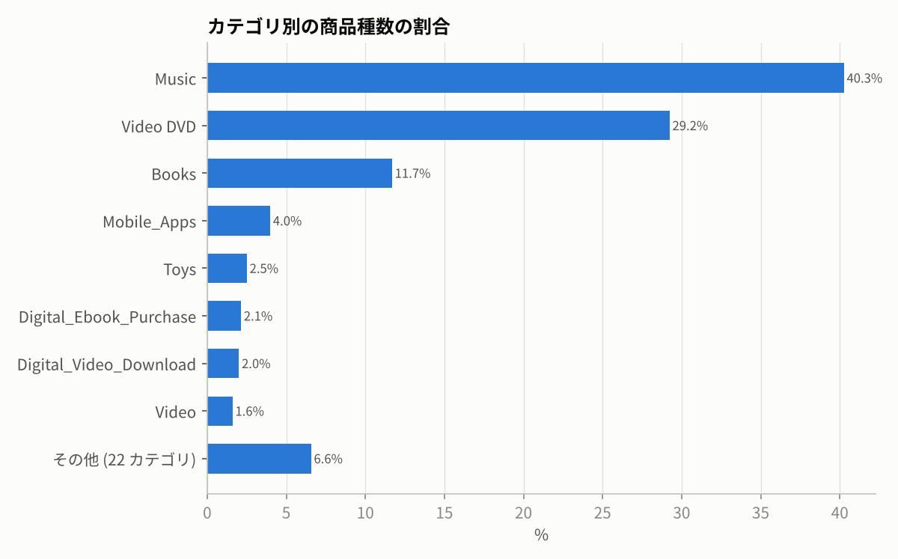
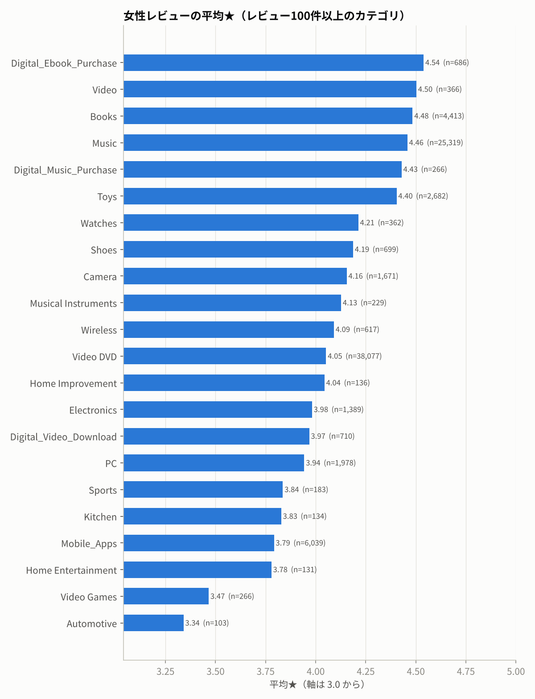

# AWS Review Analytics Pipeline

Amazon のレビューデータ（約17万件）を題材に、AWS 上で **収集・蓄積 → カタログ化 → 加工 → 分析（SQL / 生成AI）→ 可視化** までのデータ分析基盤を構築したリポジトリです。
マネジメントコンソールで手作業で組んだ構成を、**すべて CloudFormation（IaC）とコードに起こし直し**、さらに DuckDB でローカル再現して**実データで結果を検証**しています。


**使用技術:** Amazon S3 / AWS Glue (Data Catalog, Crawler, ETL, Workflow, DataBrew) / Amazon Athena / Amazon Bedrock (Nova Lite) / Amazon Quick / Amazon EventBridge / AWS IAM / AWS CloudFormation / Python (PySpark, boto3, pandas, DuckDB) / GitHub Actions

---

## アーキテクチャ



詳細と設計判断 → [docs/architecture.md](docs/architecture.md)

## 何ができることを示しているか

| テーマ | やったこと | 根拠 |
|---|---|---|
| **IaC** | S3・Glue・DataBrew・Athena・Bedrock ジョブ・EventBridge・IAM を 4 スタックで定義、依存順にデプロイ | [`infra/cloudformation/`](infra/cloudformation), [`scripts/deploy.sh`](scripts/deploy.sh) |
| **データカタログ** | Crawler でスキーマ登録。データを調べ、クォート付き CSV で列ずれが起きる問題をカスタム分類子で回避 | [architecture.md §2](docs/architecture.md#2-csv-のクォートに対応するカスタム分類子) |
| **データ加工** | DataBrew レシピ（小文字化・グループ平均・One-Hot）を 2 データセットで再利用 / Glue ETL で Parquet 化 | [`databrew/recipe.json`](databrew/recipe.json), [`glue/jobs/`](glue/jobs/reviews_to_parquet.py) |
| **クエリ最適化** | 列指向・圧縮・パーティションで Athena のスキャン量を **0.13%** に削減（実測） | [下記](#結果ハイライト) |
| **生成 AI 活用** | Bedrock でレビューを要約・感情判定し、★評価とのギャップを検出。ノートブックを再現性・耐障害性のあるジョブに作り直し | [`bedrock/analyze_reviews.py`](bedrock/analyze_reviews.py) |
| **自動化** | cron による定期実行と、S3 へのファイル到着をトリガーにしたイベント駆動実行 | [`04-automation.yaml`](infra/cloudformation/04-automation.yaml) |
| **SQL** | 集計・結合・HAVING・information_schema。結果の偏り（少数サンプル）まで読んで改善 | [`sql/`](sql), [docs/additional-tasks.md](docs/additional-tasks.md) |
| **品質** | cfn-lint・ruff・pytest（22 件）を GitHub Actions で実行 | [`.github/workflows/ci.yml`](.github/workflows/ci.yml) |

## 結果ハイライト

> 数値はすべて `python local/run_local.py` で実データ（170,296 件）に対して計測したもの。全結果 → [docs/local-results.md](docs/local-results.md)

### CSV → Parquet + パーティションで、読むデータ量が 約 1/770 に

同じ SQL（Books カテゴリで平均★4.5 以上の商品）を、元の CSV と Glue ETL 後の Parquet テーブルに投げた比較。結果は 2,218 行で完全一致。



Athena は**スキャン量で課金**されるため、これはそのままクエリコストの削減率になる。

### 同じレシピを別データに再利用

| dataset | 行数 | 列数 | 追加された列 |
|---|---:|---|---|
| reviews | 170,296 | 17 → 22 | `product_title_lower`, `category_star_rating_mean`, `product_star_rating_mean`, `verified_purchase_Yes/No` |
| reviews_add | 149,656 | 17 → 22 | 同上（スキーマ一致を自動検証） |

### 可視化（Quick の代替として matplotlib で再現）

| | |
|---|---|
|  |  |
|  |  |

「女性の平均評価が高いカテゴリ」は、素直に並べると女性レビューが 2 件しかないカテゴリが 1 位（★5.0）になる。件数を併記し 100 件以上に絞って、使えるランキングにした → [additional-tasks.md](docs/additional-tasks.md#3-1-女性の平均評価が高い順に-product_category)

## リポジトリ構成

```
infra/cloudformation/
  01-datalake.yaml          S3, Glue DB / 分類子 / Crawler ×3, IAM, Athena ワークグループ
  02-databrew-recipe.yaml   DataBrew データセット ×2, レシピ
  03-processing.yaml        DataBrew ジョブ (profile, recipe ×2), Glue ETL, Bedrock 分析ジョブ
  04-automation.yaml        定期実行 (cron) / イベント駆動 (EventBridge → Glue Workflow)
glue/jobs/reviews_to_parquet.py   Glue ETL (PySpark)
bedrock/analyze_reviews.py        Bedrock 一括分析 (Glue Python shell / ローカル両対応)
databrew/recipe.json              DataBrew レシピ (API 形式)
sql/handson/                      ハンズオンの各ステップの SQL
sql/additional/                   発展課題の SQL (STEP ごと)
local/                            DuckDB によるローカル再現 + グラフ生成
scripts/                          deploy / run / destroy / Athena 実行 / xlsx→csv
tests/                            pytest (合成フィクスチャ)
docs/                             設計・課題回答・用語・実行結果
```

## 動かし方

### ローカル再現（AWS アカウント不要）

```bash
pip install -r requirements-dev.txt
python scripts/xlsx_to_csv.py <amazon_reviews_5.xlsx>   data/amazon_reviews_5.csv
python scripts/xlsx_to_csv.py <amazon_reviews_add.xlsx> data/amazon_reviews_add.csv
python local/run_local.py        # → docs/local-results.md, docs/images/*.png
pytest -q                        # データが無くても合成フィクスチャで実行可
```

### AWS へデプロイ

前提: AWS CLI v2、東京リージョン、Bedrock で Nova Lite のモデルアクセスを有効化済み

```bash
AWS_REGION=ap-northeast-1 ./scripts/deploy.sh     # 4スタック作成 + データ/スクリプト配置 + レシピ公開
./scripts/run_pipeline.sh                         # Crawler → DataBrew → ETL → Bedrock → Crawler を順に実行
python scripts/athena_query.py sql/handson/h3_books_high_rating_csv.sql       # スキャン量も表示
python scripts/athena_query.py sql/handson/h3_books_high_rating_parquet.sql

# イベント駆動の確認: raw/ にファイルを置くとワークフローが起動する
aws s3 cp data/amazon_reviews_add.csv s3://<bucket>/raw/amazon_reviews/new.csv

./scripts/destroy.sh                              # 後片付け（バケットを空にしてから全スタック削除）
```

Quick のデータセットは [`sql/handson/h4_quick_dataset.sql`](sql/handson/h4_quick_dataset.sql) をカスタム SQL として登録する。

## 発展課題

| 課題 | 回答 |
|---|---|
| DataBrew レシピを別データに再利用 | [docs/additional-tasks.md §1](docs/additional-tasks.md#1-databrew-のレシピを別データに再利用する) |
| Glue 処理の自動化（定期 / データ格納時） | [§2](docs/additional-tasks.md#2-glue-の処理を自動化する) |
| Athena クエリの編集（女性×カテゴリ / 年齢 / information_schema） | [§3](docs/additional-tasks.md#3-athena-のクエリを書き換えて別の情報を取り出す) |
