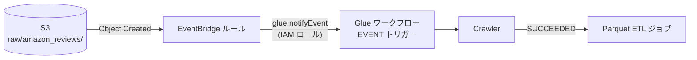
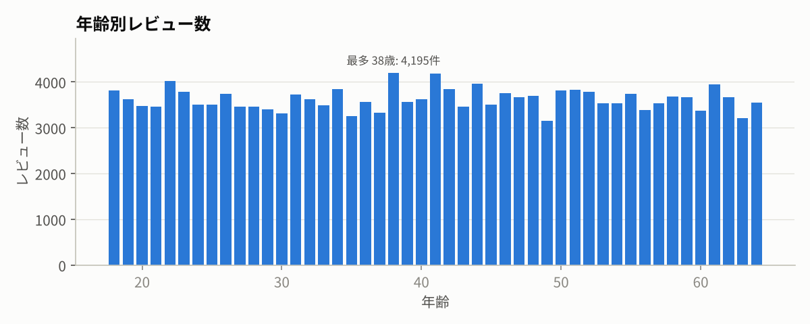

# 発展課題への回答

## 1. DataBrew のレシピを別データに再利用する

DataBrew の構成要素は「**データセット**（どこにある何形式のデータか）」「**レシピ**（変換手順）」「**ジョブ**（データセット × レシピを実行して出力する）」の3つに分かれている。レシピはデータから独立しているので、再利用するときに変えるのは入力と出力だけ。

| 問い | 答え | このリポジトリ |
|---|---|---|
| 何を準備するか | ① 追加データを S3 に置く ② それを指す**新しいデータセット** ③ レシピを**公開（publish）**してバージョンを固定 | `ReviewsAddDataset`（`02-databrew-recipe.yaml`）、`deploy.sh` の `publish-recipe` |
| 何を動かすか | 新データセット × 同じレシピバージョンの**レシピジョブ** | `RecipeJobAdd`（`03-processing.yaml`） |
| 完了をどう確認するか | ジョブ実行ステータスが SUCCEEDED → 出力先に Parquet ができている → Crawler でテーブル化 → Athena でプレビューし、新しい列（`product_title_lower` 等）があること | `scripts/run_pipeline.sh`、`sql/handson/h2_databrew_output_preview.sql` |

注意点: レシピは「列名」で処理を指定しているので、追加データの**列名・型が同じ**であることが前提。列が欠けているとジョブが失敗する。
ローカル再現では同じ `databrew/recipe.json` を両データに適用し、出力スキーマが一致することを自動で検証している（17列 → 22列、[local-results.md](local-results.md)）。

## 2. Glue の処理を自動化する

### 2-1. 定期実行（時間トリガー）
Glue のトリガーに `Type: SCHEDULED` と cron 式を設定する。Glue / EventBridge の cron は **6 フィールド・UTC**。

```
cron(分 時 日 月 曜日 年)
cron(0 15 * * ? *)   ← 毎日 15:00 UTC = 日本時間 0:00
```
「日」と「曜日」は片方を `?` にする（両方指定は不可）。
実装: `ScheduledWorkflow` + `ScheduledStartTrigger`（`04-automation.yaml`）。Crawler 成功後に ETL ジョブを続けて動かす条件付きトリガーも付けた。DataBrew のジョブは Glue ワークフローのノードにできないため、`AWS::DataBrew::Schedule` で別にスケジュールしている。

### 2-2. データ格納時実行（イベントトリガー）

**オレンジの箱に入るのは EventBridge**。ただし Glue Crawler は EventBridge のターゲットに直接指定できないので、間に **Glue ワークフロー**を挟む。



| 設定 | 値 | ポイント |
|---|---|---|
| S3 | `EventBridgeConfiguration: EventBridgeEnabled: true` | これを有効にしないと S3 のイベントが EventBridge に流れない |
| EventBridge ルール（トリガー） | `source: aws.s3`, `detail-type: Object Created`, バケット名と `prefix: raw/amazon_reviews/` | prefix で絞らないと、ETL が書き出したファイルや Athena の結果ファイルでも発火して無限ループ・無駄実行になる |
| EventBridge ルール（ターゲット） | Glue ワークフローの ARN ＋ `glue:notifyEvent` を許可したロール | |
| Glue トリガー | `Type: EVENT`、`EventBatchingCondition`（例: 1件 or 300秒） | 複数ファイルがまとめて置かれたときに、1回の実行にまとめられる |

確認方法（課題の 6.）:
```bash
aws s3 cp data/amazon_reviews_add.csv s3://<bucket>/raw/amazon_reviews/new_reviews.csv
aws glue get-workflow-runs --name review-analytics-wf-on-upload --max-results 1
aws glue get-crawler --name review-analytics-crawler-raw --query Crawler.State
```

## 3. Athena のクエリを書き換えて別の情報を取り出す

SQL の各句が「どの順番で効くか」を押さえると、STEP ごとの変化が理解しやすい。

```
FROM → WHERE → GROUP BY → HAVING → SELECT → ORDER BY → LIMIT
（どこから）（行を絞る）（まとめる）（まとめた後に絞る）（取り出す列）（並べる）（件数）
```

### 3-1. 女性の平均評価が高い順に product_category

| STEP | 追加した句 | SQL |
|---|---|---|
| 1 | `WHERE gender = 'W'` で女性の行だけにする | [a1_step1](../sql/additional/a1_step1_female_categories.sql) |
| 2 | `GROUP BY product_category` でカテゴリごとに1行にまとめる | [a1_step2](../sql/additional/a1_step2_female_categories_grouped.sql) |
| 3 | `AVG(star_rating)` を計算し `ORDER BY ... DESC` | [a1_step3](../sql/additional/a1_step3_female_categories_by_avg_rating.sql) |
| 発展 | `COUNT(*)` を出し `HAVING COUNT(*) >= 100` | [a1_extra](../sql/additional/a1_extra_female_categories_reliable.sql) |

STEP3 の結果は 1 位が `Lawn and Garden`（平均 5.0）だが、これは女性の**レビューが2件しかない**カテゴリがたまたま満点なだけ。件数を併記して 100 件以上に絞ると、`Digital_Ebook_Purchase`（4.54, n=686）、`Video`（4.50, n=366）、`Books`（4.48, n=4,413）、`Music`（4.46, n=25,319）が上位になり、意思決定に使えるランキングになる。


### 3-2. レビュー数が多い順に age

| STEP | SQL |
|---|---|
| 1 `SELECT age` | [a2_step1](../sql/additional/a2_step1_age.sql) |
| 2 `GROUP BY age` | [a2_step2](../sql/additional/a2_step2_age_grouped.sql) |
| 3 `COUNT(review_id)` で `ORDER BY ... DESC` | [a2_step3](../sql/additional/a2_step3_age_by_review_count.sql) |

最多は 38 歳（4,195 件）だが、18〜64 歳がほぼ均等（約 3,100〜4,200 件）に分布している。年齢は分析用に付与された値と考えられ、「どの年代が多いか」から強い示唆は引き出しにくい。**結果を見てデータ自体の性質を疑う**のも分析の一部。



### 3-3. information_schema でテーブル情報を引く

Athena は Glue Data Catalog の中身を、標準 SQL の `information_schema` として見せている。

| STEP | SQL |
|---|---|
| 1 全テーブルの `table_schema, table_name, table_type` | [a3_step1](../sql/additional/a3_step1_information_schema.sql) |
| 2 `WHERE table_name = 'amazon_reviews'` で絞る | [a3_step2](../sql/additional/a3_step2_information_schema_amazon_reviews.sql) |

結果: `table_schema = review_analytics`（= Glue のデータベース名）、`table_name = amazon_reviews`、`table_type = BASE TABLE`。
STEP2 では `table_schema` でも絞っている。アカウント内のデータベースが多いと、`information_schema` への問い合わせは全データベースのメタデータを見に行くため遅くなるから。
