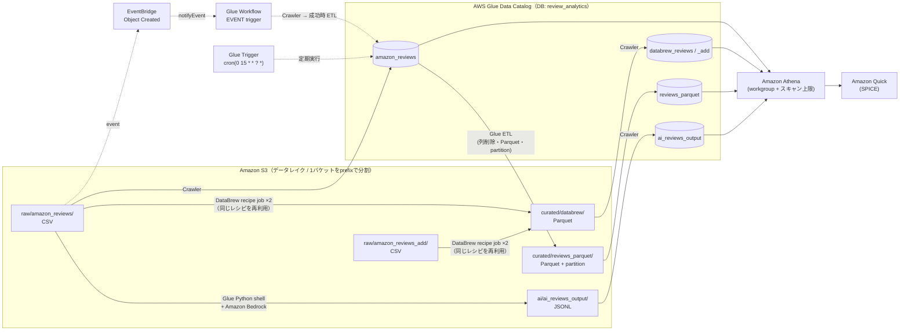

# アーキテクチャと設計判断

## 全体像

| レイヤー | サービス | このリポジトリでの役割 | 定義場所 |
|---|---|---|---|
| 蓄積 | S3 | raw / curated / ai / athena-results を prefix で分離。暗号化・パブリックアクセス遮断・HTTPS 強制 | `01-datalake.yaml` |
| カタログ | Glue Data Catalog / Crawler | S3 上のファイルのスキーマ（メタデータ）を登録し、SQL で引ける「テーブル」にする | `01-datalake.yaml` |
| 加工（GUI） | Glue DataBrew | ノーコードの前処理をレシピとして保存し、別データにも再適用 | `02-databrew-recipe.yaml`, `03-processing.yaml`, `databrew/recipe.json` |
| 加工（ETL） | Glue ETL (Spark) | CSV → Parquet/Snappy、パーティション化、カタログ自動更新 | `03-processing.yaml`, `glue/jobs/reviews_to_parquet.py` |
| 分析 | Athena | S3 上のデータにサーバーレスで SQL | `sql/`, `scripts/athena_query.py` |
| 分析（AI） | Bedrock | レビュー本文の要約・感情判定・★とのギャップ検出 | `bedrock/analyze_reviews.py` |
| 可視化 | Quick | Athena をデータソースにしたダッシュボード（本リポジトリでは matplotlib で代替再現） | `sql/handson/h4_quick_dataset.sql`, `local/charts.py` |
| 自動化 | EventBridge / Glue Workflow / Trigger | 定期実行とファイル到着時実行 | `04-automation.yaml` |

## 設計判断（なぜそうしたか）

### 1. スタックを4つに分けた
`データレイク基盤 → DataBrew レシピ → 処理ジョブ → 自動化` の順に依存しており、変更頻度も違う（バケットはほぼ不変、ジョブは頻繁に変わる）。`Export / ImportValue` で疎結合にし、上位スタックだけ作り直せるようにした。
DataBrew は**ジョブが「公開済み」レシピのバージョンを参照する**仕様なので、レシピ作成（2）とジョブ作成（3）の間に `publish-recipe` を挟む必要がある。`scripts/deploy.sh` がこれを担う。

### 2. CSV のクォートに対応するカスタム分類子
データを確認したところ、`product_title` にカンマを含む行が 13 件、`review_headline` に 1 件あり、その行だけ `"..."` で囲まれていた。Crawler の組み込み CSV 分類子は `LazySimpleSerDe` を選び、これはクォートを解釈しないため **その行だけ列がずれる**。`QuoteSymbol: '"'` を持つカスタム分類子を付け、`OpenCSVSerDe` が使われるようにした。
（改行を含む本文は 0 件であることも確認済み。改行があると CSV のままでは Athena で正しく読めないため、その場合は ETL で JSON/Parquet 化が必須になる。）

### 3. DataBrew の出力は `Overwrite: true`
既定ではジョブ実行のたびに `<ジョブ名>_<タイムスタンプ>/` フォルダが増える（手作業のときに Crawler の参照先としてこのフォルダを選んでいたのはこのため）。上書きにしておくことで、Crawler の参照パスを固定でき、自動化しやすい。

### 4. Parquet + パーティション（Athena のコスト = スキャン量）
Athena は**スキャンしたバイト数で課金**される。`WHERE product_category = 'Books'` で 2 列しか使わないクエリでも、CSV（行指向・非分割）ではファイル全体を読む。

| 効く仕組み | 何が減るか |
|---|---|
| 列指向（Parquet） | 参照しない列を読まない |
| 圧縮（Snappy） | 読むバイト自体が減る |
| パーティション（`product_category=Books/`） | 関係ないフォルダを読まない（partition pruning） |
| 不要列の削除（`total_votes`, `vine`） | ファイル全体が小さくなる |

ローカル再現での実測: **148.7 MB → 197.6 KB（0.13%）**。詳しくは [local-results.md](local-results.md)。
パーティションキーは「よく WHERE に使う」「値の種類が多すぎない」列を選ぶ。カテゴリは 30 種類なので適切だが、`product_id` のような高カーディナリティ列でパーティションを切るとファイルが細かくなりすぎて逆に遅くなる。日付で絞る分析が多いなら `review_year` なども候補。

### 5. Glue ETL はジョブブックマークを有効化
`transformation_ctx` を付けたうえで `--job-bookmark-option job-bookmark-enable` にすると、前回までに処理した S3 オブジェクトはスキップされる。ファイル到着ごとにワークフローが走る構成では、毎回全件を再変換しないために必須。

### 6. Athena ワークグループで「設定忘れ」と「事故」を防ぐ
- 結果の保存先と暗号化をワークグループ側で強制（各自がクエリ設定で保存先を入れる手順が不要になる）
- `BytesScannedCutoffPerQuery`（既定 1 GiB）で、誤った全件スキャンを途中で止める
- 結果ファイルは S3 ライフサイクルで 30 日後に自動削除

### 7. IAM は用途ごとに分け、最小権限
| ロール | 使う主体 | 権限 |
|---|---|---|
| `*-glue-role` | Crawler / ETL | データバケットの読み書きのみ |
| `*-databrew-role` | DataBrew | 同上 |
| `*-bedrock-job-role` | Bedrock 分析ジョブ | `bedrock:InvokeModel` と、`ai/` 配下への書き込みのみ |
| `*-events-to-glue-role` | EventBridge | 対象ワークフローへの `glue:notifyEvent` のみ |

### 8. Bedrock 分析はノートブックではなくジョブに
対話型ノートブックは検証には便利だが、定期実行や他処理との連結ができず、停止忘れで課金が続く。Glue Python shell ジョブ（0.0625 DPU）にして、パラメータで件数とモデルを変えられるようにした。コード面での改善点:

| 改善 | 理由 |
|---|---|
| `invoke_model` → **Converse API** | モデル固有のリクエスト形式に依存しない（Nova / Claude 等を ID だけで切替） |
| `temperature=0` | 同じレビューに同じラベルが付く（再現性） |
| botocore の adaptive リトライ + 失敗行は記録して継続 | スロットリングで一括処理全体が落ちない |
| **★評価ごとの層化サンプリング** | データの 57% が★5。先頭 100 件だと低評価がほぼ含まれず、「★が低いのに本文はポジティブ」のギャップを検出できない |
| `gap_reason` も出力 | 「なぜギャップか」が分析で一番使える情報なのに捨てていた |
| `gap_flag`（Neutral除く）と `gap_flag_broad`（Neutral含む）の両方を出力 | 判定基準がスクリプトと SQL で食い違っていたのを明示的に分けた |
| CSV をストリーミングで読む | ファイルサイズに比例してメモリが増えない |

## コスト感（東京リージョン、本データ規模）
- S3: 数百 MB → 月数円
- Athena: 1 TB スキャンあたり数ドル課金なので、CSV 1 回 ≒ 0.15 GB、Parquet 化後は KB 単位
- Glue ETL / Crawler / DataBrew: DPU・ノード時間課金。ワーカー数・ノード数を最小（2）に固定
- Bedrock: 入出力トークン課金。`AiMaxRecords`（既定 100）で上限をかける
- 定期実行トリガーは既定で無効（`EnableSchedule=false`）。使い終わったら `scripts/destroy.sh`
