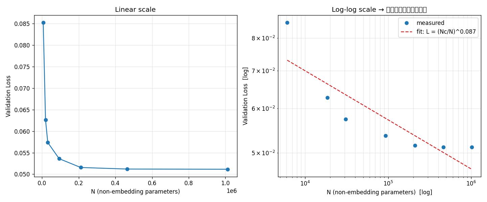

# LLM を最小構成でゼロから実装して理解する

> 大規模言語モデル（LLM）の中核技術を、既存ライブラリに頼らず **PyTorch で最小実装** し、
> 各技術が「なぜそう設計されているのか」を **自分の手で実験して確かめた** 学習記録です。

東京大学 松尾・岩澤研究室「大規模言語モデル講座（全8回）」で学んだ内容を土台に、
数式として学んだ概念を **動くコードと数値実験に落とし込み**、
理解の解像度を上げることを目的としています。

> **本リポジトリは受講内容をもとに独自に再実装したもので、講座の配布物は含まない。**
> 講義スライド・配布ノートブック・配布データ・宿題や確認テストの問題と解答は掲載していません。
> 説明文は自分の言葉で書き、コードはすべてゼロから書き直したオリジナル実装です。

### 講座の構成と本リポジトリの対応

| 回 | テーマ | 主なトピック | 本リポジトリ |
|----|--------|-------------|-------------|
| 1 | 講座概要 | 生成確率としての言語モデル、自己回帰、Transformer、スケール則、基盤モデル、ロボット応用（RT-1, π0） | — |
| 2 | 推論 | Zero/Few-shot、CoT、Self-Consistency、Self-Refine、デコーディング（Greedy / Top-k / Top-p / Temperature）、LLM-as-a-Judge | [day2/](day2) |
| 3 | 事前学習 | Attention（Q/K/V）、Causal Mask、Multi-Head、FFN、LayerNorm、次トークン予測 | [day3/](day3) |
| 4 | スケール則 | L(N, D, C) のべき乗則、FLOPs ≈ 6ND、Chinchilla（D ≈ 20N）、μP、推論時スケーリング | [day4/](day4) |
| 5 | 事前学習（上級） | Sparse Attention、FlashAttention、MoE、量子化（LLM.int8()）、分散学習 | [day5/](day5) |
| 6 | ファインチューニング | Instruction Tuning、SFT、PEFT（LoRA / Adapter / Prompt Tuning / BitFit） | [day6/](day6) |
| 7 | 強化学習 | RLHF（報酬モデル＋PPO）、DPO、RLVR、GRPO、DAPO、Dr. GRPO | [day7/](day7) |
| 8 | データと評価 | 前処理（URL フィルタ・言語判定・MinHash 重複除去）、Self-Instruct、ベンチマーク、LLM-as-a-Judge、Chatbot Arena | [day8/](day8) |

**最終課題**: 小規模 LLM に QLoRA → DPO を適用し、LLM-as-a-Judge による安全性スコアを **Base < QLoRA < DPO** の順に改善した（課題のコードと配布データは規約により非掲載）。

---

## この学習で示したいこと

- Transformer / 事前学習 / スケール則 / ファインチューニング / 強化学習 / 評価 という
  **LLM 開発の全パイプラインを、部品レベルから説明・実装できる**
- 論文の主張（例: Chinchilla則、LoRA、DPO）を **鵜呑みにせず、手元の実験で検証する** 姿勢
- GPU 環境（RTX 5060 / Blackwell 世代）の構築を含め、**自力で再現可能な形にまとめる** 力

---

## リポジトリ構成

各テーマごとに「基礎編（動かして体感）」と「深掘り編（数式の"なぜ"を検証）」の2段構成にしています。
**各ディレクトリの README に、実際の実行結果（ターミナル出力）を掲載しています。**

| テーマ | 基礎編 | 深掘り編 |
|--------|--------|----------|
| **デコーディング / Self-Consistency** | [day2/sampling.py](day2/sampling.py) | [day2/experiment.py](day2/experiment.py) |
| **Transformer** | [day3/day3_transformer.py](day3/day3_transformer.py) | [day3/day3_transformer_deepdive.py](day3/day3_transformer_deepdive.py) |
| **スケール則** | [day4/day4_scaling_law.py](day4/day4_scaling_law.py) | [day4/day4_chinchilla_deepdive.py](day4/day4_chinchilla_deepdive.py) |
| **MoE / 量子化 / Attention の計算量** | [day5/moe.py](day5/moe.py) ほか | [day5/experiment.py](day5/experiment.py) |
| **ファインチューニング (SFT/LoRA)** | [day6/day6_sft_lora.py](day6/day6_sft_lora.py) | [day6/day6_lora_deepdive.py](day6/day6_lora_deepdive.py) |
| **強化学習 (RLHF/DPO/GRPO)** | [day7/day7_dpo.py](day7/day7_dpo.py) | [day7/day7_rl_deepdive.py](day7/day7_rl_deepdive.py) |
| **データ整備と評価** | [day8/day8_data_and_eval.py](day8/day8_data_and_eval.py) | [day8/day8_data_eval_deepdive.py](day8/day8_data_eval_deepdive.py) |

---

## ハイライト（手を動かして確かめたこと）

### 1. Transformer をゼロから実装
Self-Attention / Multi-Head / Positional Encoding をすべてスクラッチで書き、
超小型 GPT を学習させて「次単語予測」から文章生成までを再現。

**深掘りで検証した "なぜ":** Attention で `√d_k` で割る理由を数値実験で確認。
内積の分散が次元 `d_k` に比例して増大し（d_k=64 → 分散 64.2）、
`√d_k` で割ると分散≈1 に正規化されることを実測。これを怠ると softmax が飽和し勾配が消える。

### 2. スケール則と Chinchilla 則
モデルサイズを変えて学習し、損失が両対数グラフ上で直線（べき乗則）に乗ることを確認。



**深掘りで検証した "なぜ":** 計算量 `C ≈ 6ND` の下で最適な N/D 配分を探索し、
**GPT-3（D/N=1.7）はモデルが大きすぎ・データ不足**であることを再現。
同じ計算予算でも小さいモデルを多くのデータで訓練した方が損失が下がる、という
Chinchilla の主張を数値で確認した。さらに推論コストまで含めると最適サイズが変わる
（Beyond Chinchilla）ことも実験。

### 3. ファインチューニング: SFT と LoRA
事前学習だけでは指示に従えないモデルが、SFT で質問応答できるようになる過程を実装。
**LoRA は全体の 7% のパラメータ更新だけで Full-FT と同精度**を達成することを確認。

**深掘りで検証した "なぜ":** LoRA の B 行列をゼロ初期化することで学習開始時の増分 ΔW=0 になること、
学習後に ΔW を元の重みへマージすると出力が一致し（誤差 1.2e-6）
**推論オーバーヘッドがゼロ**になることを実証。これが LoRA が主流になった決定的理由。

```text
=== Full-FT vs LoRA 比較まとめ ===
Full-FT 学習対象パラメータ: 230,364 (100%)
LoRA    学習対象パラメータ:  16,384 (7.11%)
→ 7.11% の更新だけで Full-FT と同じ質問応答精度を達成
```

### 4. 強化学習: RLHF / DPO / GRPO
「丁寧な回答」を好むよう選好データから学習させる過程を DPO で実装。

**深掘りで検証した "なぜ":** Bradley-Terry モデルで選好データだけから報酬の構造を復元できること、
DPO では正規化項 Z(x) が消えて **報酬モデルなしに方策を直接最適化できる** 数理を確認。
GRPO のグループ内標準化で価値モデル（Critic）を不要にする仕組みも実装した。

### 5. データ整備と評価
Perplexity・MinHash による重複除去・データ汚染の実演を実装。

**深掘りで検証した "なぜ":** 「最小ハッシュの一致確率 = Jaccard 係数」を
モンテカルロ実験で証明（1万回試行、誤差 0.004）。
また、テスト問題を学習データに混ぜると正解率が **0.02% → 99%** に跳ね上がる
データ汚染の危険性を実証し、n-gram overlap による汚染検出も実装した。

---

## 実行環境と再現方法

- **OS:** Ubuntu 22.04
- **GPU:** NVIDIA RTX 5060 Laptop（Blackwell, sm_120）
- **主要ライブラリ:** PyTorch 2.11.0+cu128, NumPy, Matplotlib

```bash
git clone https://github.com/akito222/portfolio.git
cd portfolio/llm-from-scratch-notes
bash setup.sh                 # venv 作成 + 依存インストール
source .venv/bin/activate
python day3/day3_transformer.py   # 例: Transformer を学習・生成
```

> **注:** RTX 50 シリーズ（Blackwell, sm_120）は一般的な cu121 版 PyTorch では
> 非対応の警告が出て GPU を使えません。**cu128 以降**の指定が必要です（setup.sh に反映済み）。
> この環境依存のハマりどころを自力で解決した経緯も、学びの一部として記録しています。

---

## テストと CI

```bash
pip install -r requirements-test.txt   # PyTorch は別途インストール
pytest -q
```

[`tests/`](tests) に、実装した部品が数式どおりに動くかを確かめる単体テストを置いています。
（例: softmax の和が 1 になる、Causal Mask が未来のトークンを見ていない、タイル化 Attention が naive と一致する、
LoRA のゼロ初期化で出力が変わらない、DPO 損失が方策 = 参照モデルのとき log 2 になる、など）

プッシュのたびに GitHub Actions（[ワークフロー](../.github/workflows/llm-from-scratch-notes.yml)）で
テストと Day2 / Day5 の実験スクリプトを CPU で実行しています。


> Day6 / Day7 / Day8 のテストは、スクリプト本体と同じ式を関数として切り出した
> [`day6/lora.py`](day6/lora.py)・[`day7/rl_objectives.py`](day7/rl_objectives.py)・[`day8/minhash.py`](day8/minhash.py) を対象にしています。

---

## この学習記録について

本リポジトリは受講内容をもとに独自に再実装したもので、講座の配布物は含みません。
**理解を深めるための追加実験を自分で設計・実装**し、学んだ概念を自分のコードと言葉で再構成しています。
「読んで分かった気になる」で終わらせず、**手を動かして数値で確かめる**ことを一貫して重視しました。

## ライセンス

コードは MIT License の下で公開しています（[LICENSE](LICENSE) 参照）。
