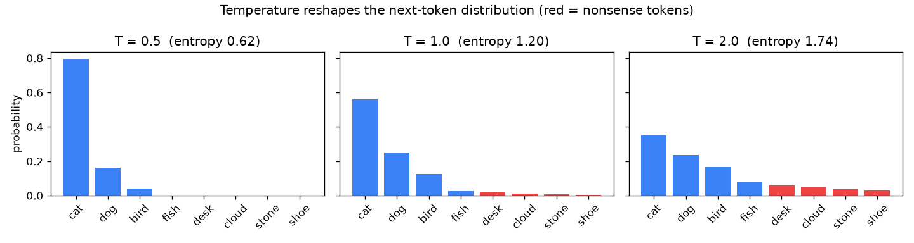
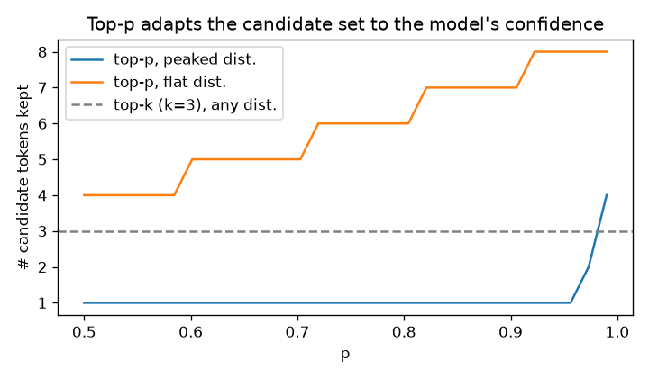
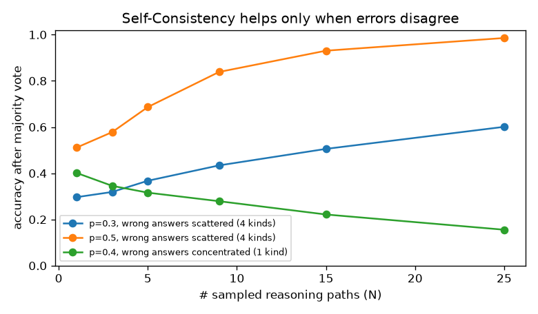

# Day2 実験結果

`python day2/experiment.py` が自動生成するファイルです。

## 実験1: 温度と分布の形

| 温度 T | 最有力 cat の確率 | 文脈的におかしい 4 語の合計確率 | エントロピー |
|---|---|---|---|
| 0.5 | 0.796 | 0.001 | 0.62 |
| 1.0 | 0.559 | 0.037 | 1.20 |
| 2.0 | 0.349 | 0.173 | 1.74 |

温度を上げるほど分布が平らになり、おかしな候補にも確率が回ってくる。

## 実験2: Top-k と Top-p の違い

| 分布 | Top-k (k=3) で残る候補数 | Top-p (p=0.9) で残る候補数 |
|---|---|---|
| 尖った分布（自信あり） | 3 | 1 |
| 平らな分布（迷っている） | 3 | 7 |

Top-k は分布の形に関係なく常に k 個。Top-p は自信がある場面では絞り、迷う場面では広げる。

## 実験3: 多様性と「おかしな語」を選ぶ率（各 1 万回）

| 設定 | 出現したトークンの種類 | おかしな語を選んだ率 |
|---|---|---|
| Greedy | 1 | 0.00% |
| T=1.0 | 8 | 3.80% |
| T=1.5 | 8 | 10.56% |
| T=1.5 + top-k=3 | 3 | 0.00% |
| T=1.5 + top-p=0.9 | 5 | 4.59% |

高温にすると多様になるが、おかしな語を選ぶ率も上がる。Top-k (k=3) は裾を完全に切るので 0% になった。
Top-p (p=0.9) は半分以下に減らしたが 0 にはならない。温度で分布が平らになると、p=0.9 に届くまでに必要な候補が増えるため。
Top-p は温度をかけた後の分布に対して働くので、温度との組み合わせで効き方が変わる。

## 実験4: Self-Consistency（多数決）の効果

| 1 回あたりの正解率と誤答の種類 | N=1 | N=3 | N=5 | N=9 | N=15 | N=25 |
|---|---|---|---|---|---|---|
| p=0.3, 誤答 4 種類 | 0.30 | 0.32 | 0.37 | 0.43 | 0.51 | 0.60 |
| p=0.5, 誤答 4 種類 | 0.51 | 0.58 | 0.69 | 0.84 | 0.93 | 0.99 |
| p=0.4, 誤答 1 種類 | 0.40 | 0.35 | 0.32 | 0.28 | 0.22 | 0.16 |

1 回の正解率が 30% でも、誤答がばらけていれば多数決で正解率が上がる。
逆に誤答が 1 種類に集中していると、多数決はその誤答を強めてしまう。
