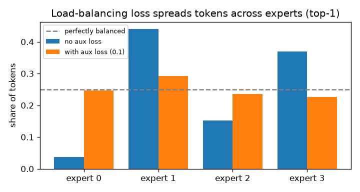
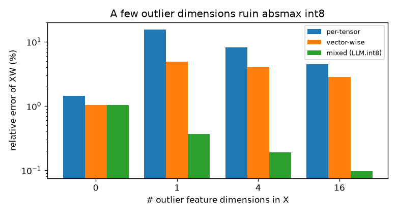
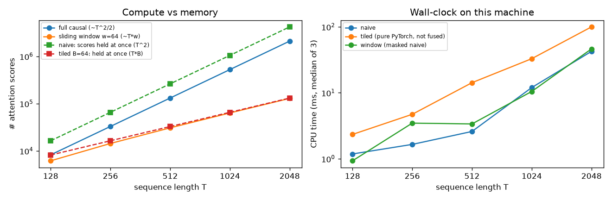

# Day5: MoE・int8 量子化・Attention の計算量を自前実装

モデルを大きくするときの 3 つの壁を、それぞれ小さな実装で確かめた。

- **計算量の壁** → MoE: パラメータは増やしても、1 トークンの計算は一部の expert だけで済ませる
- **メモリの壁（重み・活性化）** → 量子化: 16/32 bit の値を 8 bit で持つ。ただし外れ値が問題になる
- **メモリの壁（系列長）** → Attention: T×T のスコア行列を丸ごと持たずに同じ結果を出す

| ファイル | 内容 |
|---|---|
| [`moe.py`](moe.py) | Top-k ルーティングの MoE 層、負荷分散損失（Switch Transformer 型） |
| [`quantization.py`](quantization.py) | absmax int8 量子化（per-tensor / vector-wise）、外れ値を分ける LLM.int8() 型の行列積 |
| [`attention.py`](attention.py) | naive Attention、オンライン softmax によるタイル化 Attention、スライディングウィンドウ Attention |
| [`experiment.py`](experiment.py) | 3 つの実験を実行し、グラフと [`results/results.md`](results/results.md) を生成 |
| [`../tests/test_day5.py`](../tests/test_day5.py) | 単体テスト |

```bash
python day5/experiment.py   # CPU で 1〜2 分
```

---

## 要点

### MoE（Mixture of Experts）

ゲートが各 expert の重みを出し、上位 $k$ 個の expert だけを動かす。

$$g(x) = \mathrm{softmax}(x W_g), \qquad y = \sum_{e \in \mathrm{TopK}(g(x))} \tilde{g}_e(x)\, E_e(x)$$

$\tilde{g}_e$ は選ばれた $k$ 個の中で和が 1 になるよう再正規化した重み。
放っておくと一部の expert にトークンが集中するので、負荷分散損失を足す。

$$\mathcal{L}_{\mathrm{aux}} = E \sum_{e=1}^{E} f_e P_e$$

$f_e$ は expert $e$ が 1 位に選ばれたトークンの割合、$P_e$ は expert $e$ への平均ゲート確率。完全に均等なら 1 になる。

### int8 量子化（absmax）

$$s = \frac{\max |x|}{127}, \qquad q = \mathrm{round}(x / s) \in [-127, 127], \qquad \hat{x} = s\, q$$

丸め誤差は 1 要素あたり最大 $s/2$。$\max|x|$ が 1 つの外れ値で大きくなると $s$ も大きくなり、
残りの普通の値がすべて粗く丸められる。LLM.int8() は、外れ値を含む特徴次元だけを高精度のまま計算し、
残りを int8 で計算して足し合わせる。

$$XW = X_{:,O} W_{O,:} + \mathrm{int8}(X_{:,\bar{O}})\, \mathrm{int8}(W_{\bar{O},:})$$

### Attention の計算量とオンライン softmax

因果 Attention は $T(T+1)/2$ 個のスコアを計算する。naive な実装は $T \times T$ の行列を一度に持つので、メモリも $O(T^2)$。

FlashAttention の土台になっているのは、softmax を「ブロックごとに少しずつ」計算できるという性質。
K/V のブロック $b$ を処理するたびに、行ごとの最大値 $m$、分母 $\ell$、分子 $o$ を更新する。

$$m' = \max(m, \max_j s_j), \qquad \ell' = e^{m - m'} \ell + \sum_j e^{s_j - m'}, \qquad o' = e^{m - m'} o + \sum_j e^{s_j - m'} v_j$$

最後に $o / \ell$ を取ると、naive と同じ出力になる。同時に持つスコアは $T \times B$（$B$ はブロックサイズ）だけで済む。

---

## 実験結果

全結果は [`results/results.md`](results/results.md)。

### MoE: expert を増やしても 1 トークンの計算量は増えない

| expert 数（top-2） | 総パラメータ数 | 1 トークンで使うパラメータ数 |
|---|---|---|
| 2 | 8,448 | 8,448 |
| 4 | 16,896 | 8,512 |
| 16 | 67,584 | 8,896 |

### MoE: 負荷分散損失の効果（4 expert, top-1, 400 step）



| 設定 | 各 expert の担当割合 | テスト MSE |
|---|---|---|
| 負荷分散損失なし | 0.04 / 0.44 / 0.15 / 0.37 | 0.190 |
| 負荷分散損失あり（係数 0.1） | 0.25 / 0.29 / 0.23 / 0.23 | 0.443 |

損失なしでは expert 0 がほとんど使われていない。損失を入れると均等（0.25）に近づいた。
ただし、この小さなタスクと 400 step の範囲では **テスト MSE は悪化した**。負荷の均等化と精度はトレードオフになりうるので、係数は調整が必要（seed は 1 つのみ）。

### int8 量子化: 外れ値が 1 次元あるだけで誤差が跳ね上がる



| 外れ値次元の数 | per-tensor | vector-wise | mixed（LLM.int8() 型） |
|---|---|---|---|
| 0 | 1.455% | 1.048% | 1.048% |
| 1 | **15.643%** | 4.948% | **0.369%** |
| 16 | 4.501% | 2.861% | 0.097% |

（$XW$ の相対誤差。X は 256×512、外れ値の次元は値を 60 倍にしたもの）

外れ値の次元だけを高精度で計算すると、残すのが 512 次元中わずか 1〜16 次元でも、誤差は外れ値なしのとき以下に収まった。
ただしこれは出力の大きさで割った相対誤差なので、外れ値で出力が大きくなったぶん小さく見えている。外れ値が増えるほど per-tensor の誤差が下がって見えるのも同じ理由。

### Attention: T×T 行列を持たずに同じ答えを出す



| T | 因果 Attention のスコア数 | naive が同時に持つスコア | tiled（B=64）が同時に持つスコア | naive との最大誤差 |
|---|---|---|---|---|
| 512 | 131,328 | 1.00 MiB | 0.125 MiB | 3.6e-07 |
| 2048 | 2,098,176 | 16.00 MiB | 0.500 MiB | 3.0e-07 |

系列長を 4 倍にするとスコアの数は約 16 倍になる（$T^2$ に比例）。
tiled は naive と同じ出力（誤差は float32 の丸め程度）を、T×T 行列を持たずに計算できた。

ただし右のグラフのとおり、**tiled は naive より遅い**。PyTorch の演算を Python のループで並べただけだから。
FlashAttention の速さは、この計算を 1 つの GPU カーネルにまとめ、メモリの読み書きを減らすことから来る。
window の「T·w」も専用カーネルの場合の値で、ここでの実装は出力を確かめるために T×T 行列をマスクしているので速くはならない。

---

## よくある誤解

- **「MoE は expert の数だけ計算が重い」** — 1 トークンが通るのは top-k 個の expert だけ。重くなるのは総パラメータ数（メモリ）のほうで、計算量はほぼ一定
- **「MoE の各 expert は "数学担当" "コード担当" のように人間が分かる分野に分かれる」** — ゲートが学習で決めるのはトークン単位の振り分けで、きれいな分野ごとに分かれる保証はない
- **「int8 にすると精度が一律に少し落ちる」** — 精度の落ち方は値の分布しだい。外れ値が 1 次元あるだけで誤差が 10 倍以上に増え、その次元だけを高精度で扱えば大きく改善する（実験 2）
- **「FlashAttention は Attention の近似で、計算量を減らす」** — FlashAttention の出力は通常の Attention と（丸め誤差を除き）同じで、計算するスコアの数も減らない。減らすのは GPU メモリへの読み書きの量。計算量そのものを減らすのは Sparse Attention（実験 3 の window）のほうで、こちらは出力が変わる近似になる

## 自分の研究（ロボティクス）との接点

- **ロボット上での推論**: ロボットに載せる計算機は GPU メモリが限られる。VLA のような大きなモデルを動かすには、量子化が現実的な選択肢になる。ただし実験 2 のとおり、外れ値を無視した量子化は精度を大きく落とすので、量子化したモデルで把持の成功率が下がらないかを必ず確かめる必要がある
- **長い観測履歴**: 動作を決めるのに過去の画像フレームを長く参照したい場合、Attention の $O(T^2)$ がそのまま効いてくる。直近のフレームだけを見るスライディングウィンドウは、計算を減らせる代わりに、遠い過去の情報を捨てるというトレードオフになる
- **MoE と多様なタスク**: 弁当の盛り付けのように食材ごとに扱い方が違うタスクでは、入力に応じて計算経路を切り替える MoE の考え方が参考になる
